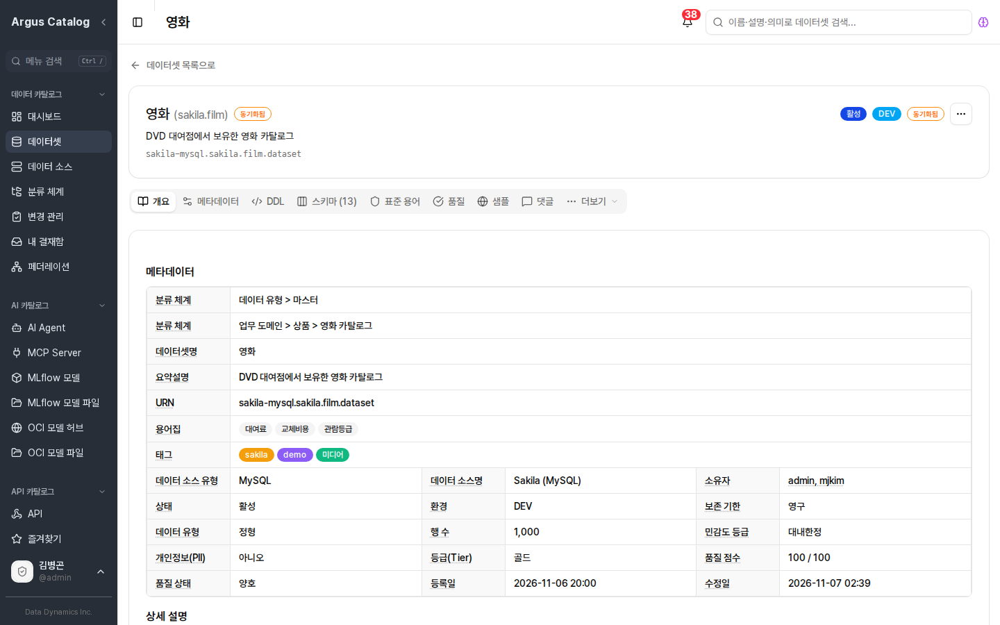
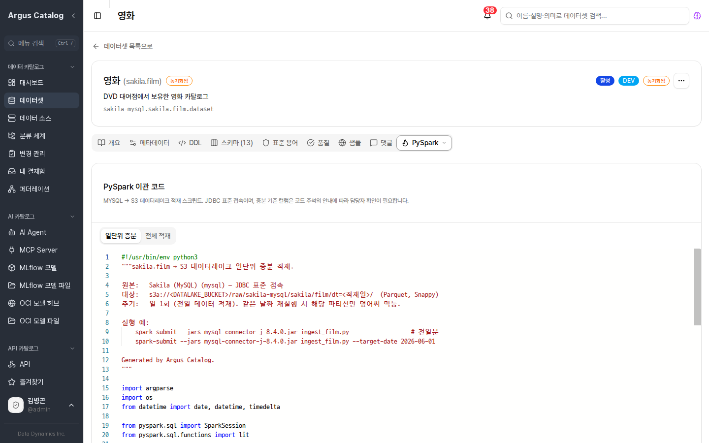

# Argus Catalog

[](https://github.com/DataDynamics-OSS/argus-catalog/actions/workflows/ci.yml)
[](LICENSE)
[](https://www.python.org/)
[](CONTRIBUTING.md)

**Argus Catalog** 는 회사 안에 흩어진 데이터·ML 모델·API·AI 에이전트를 **한 곳에서 찾고, 이해하고, 관리하는**
오픈소스 메타데이터 플랫폼입니다. 데이터 카탈로그와 MLflow 호환 모델 레지스트리를 한 제품으로 묶었고,
인터넷이 차단된 **폐쇄망(에어갭)** 에서도 그대로 동작합니다.

- **찾기** — 이름·설명·의미로 검색(키워드 + 임베딩 시맨틱 검색), 분류 체계·태그·용어집으로 탐색
- **이해하기** — 스키마·DDL·샘플·리니지·ER 다이어그램·데이터 품질 점수를 한 화면에서
- **관리하기** — 소유자·표준·변경 관리(결재)·메뉴/기능 권한·알림
- **모델과 AI 자산까지** — MLflow·OCI 모델, OpenAPI, AI Agent, MCP Server 를 같은 카탈로그에서

<p align="center">
  
  <br><sub>데이터셋 상세 — 분류·용어집·태그·소유자·품질 점수를 한 화면에서</sub>
</p>

<p align="center">
  
  <br><sub>PySpark 탭 — 원천 테이블을 데이터레이크로 옮기는 적재 코드를 자동으로 만들어 줍니다</sub>
</p>

## 5분 만에 띄워 보기

Docker 만 있으면 됩니다. 저장소 루트에서:

```bash
docker compose -f deploy/docker-compose.yml up -d --build
```

| 접속 | 주소 |
|------|------|
| 웹 화면 | http://localhost:3000 |
| API 문서 (Swagger) | http://localhost:4600/docs |

처음 로그인은 `admin` / `admin` 입니다. 로그인하면 **비밀번호 변경 화면**이 먼저 나오니 새 비밀번호로 바꾸세요.
그다음 *데이터 카탈로그 → 데이터 소스* 에서 사내 DB 를 등록하고 메타데이터를 동기화하면 데이터셋이 채워집니다.
샘플 데이터(Sakila)와 다른 구성은 [`deploy/README.md`](deploy/README.md) 를 참고하세요.

> 기본 계정·비밀번호는 로컬 데모용입니다. 운영에 올리기 전에 [운영 환경 보안 설정](#운영-환경-보안-설정-️)을 꼭 확인하세요.

## 무엇을 할 수 있나요

기능을 대분류 → 중분류 → 소분류(세부 기능)로 정리했습니다.

| 대분류 | 중분류 | 소분류 |
|--------|--------|--------|
| **데이터 카탈로그** | 데이터 소스 | 조직 → 시스템 → 데이터 소스 트리 · 11종 데이터 소스(MySQL·PostgreSQL·Oracle·SQL Server·Hive·Impala·Trino·StarRocks·Greenplum·Kudu·Iceberg REST) 등록 · 연결 테스트 · 메타데이터 동기화 · 데이터 소스 전체 ER 다이어그램 · 삭제 전 영향 확인 |
| | 데이터셋 | 목록 · 검색 · 필터(표 · 카드 보기) · 개요 · 스키마 · DDL · 샘플 데이터 · 스키마 편집과 변경 이력 · 확장 메타데이터(민감도 · 보존 · 규제 태그 등) · 소유자 · 태그 · 용어 연결 · 커스텀 속성 · 댓글 |
| | 리니지 · 관계 | 리니지 그래프(컬럼 매핑 · 파이프라인) · 조인 관계 그래프 · ER 다이어그램(FK) · 쿼리 수집기(Hive·Impala·Trino·StarRocks) 기반 관계 분석 |
| | 분류 체계 | 분류체계 · 분류 트리(드래그 정렬) · 데이터셋 매핑 · 분류별 / 미분류 데이터셋 |
| | 검색 | 통합 검색(데이터셋 · 용어 · AI Agent · API · MCP) · 키워드 + 임베딩 시맨틱(하이브리드) 검색 · 임베딩 재계산 |
| | 스키마 · 적재 코드 | Avro 스키마(편집 · 외부 조회 API) · Confluent 호환 스키마 레지스트리 · 적재 코드 자동 생성(PySpark · Kestra · Airflow) |
| | 대시보드 | 핵심 지표 카드 · 데이터 소스 유형 · 환경별 분포 · 신규 데이터셋 추이 · 최근 데이터셋 |
| **데이터 품질** | 프로파일링 | 컬럼 통계(행 수 · NULL · 고유값 · 최소/최대 · 최빈값) — 품질 워커가 수집 |
| | 품질 규칙 | 필수값 · 중복 · 범위 · 허용 값 · 정규식 · 날짜 형식 · 글자 깨짐 · 공백 · 더미 값 · 연속성 · 컬럼 간 비교 · 논리관계 · 참조관계 · 최신성 · Trino 함수 · 커스텀 SQL / Python · 규칙 추천 · 진단 쿼리 보기 |
| | 정밀 진단 | 품질 워커의 전수 진단 — Trino 경로 또는 원천 직접(PostgreSQL · MySQL · Oracle · SQL Server) · 위반 샘플 · 실행 현황 · 취소 · 다시 실행 |
| | 품질 지표 | 공공데이터 품질관리 지침 진단 기준 16개 · AI-Ready 품질 지표(완전성 · 일관성 · 적시성 · 유효성 등) · 기본 지표 · 컬럼 할당 |
| | 품질 진단 작업 | 데이터셋 · 지표 단위 작업 · 주기 실행(매시간 · 매일 · 매주 · 매월) · 프로파일 함께 수집 · 작업 이력 |
| | 리포트 · 점수 | 오류율 · 진단 기준별 · 지표별 · 규칙별 리포트 · 엑셀 · PDF 내려받기 · 품질 점수와 추이 · 업스트림 품질 경고 |
| **AI-Ready 공공데이터** | AI 활용 메타데이터 | 행정안전부 「공공데이터의 인공지능 친화적 관리 가이드라인」 항목(제공기관 · 라이선스 · 허용 용도 · 시간 · 공간 범위 · 편향 · 한계 · 개인정보 조치 등) · 기관 기본값 · 데이터 버전 이력 |
| | AI-Ready 점검 | 부록 4 체크리스트 자동 판정 · 수동 판정 · 필수 / 권장 충족률 · 전체 데이터셋 점검 목록 |
| | 배포 · 내보내기 | 배포본(접근 주소 · 형식 · 체크섬) · DCAT · Croissant 1.0 · 데이터 카드(Markdown) · 외부 공개 주소 설정 |
| | 이용자 피드백 | 오류 신고 · 개선 요청 접수 · 처리 기한 · 처리 상태(처리 중 · 해결 · 소명) · 오류 신고 처리 화면 |
| | AI-Ready 알림 · 초안 | 최소 요건 미충족 · 신고 접수 · 처리 기한 알림 · LLM 초안(편향 · 한계 · 관련법령) |
| **거버넌스** | 데이터 표준 | 표준 사전 · 단어 · 도메인 · 용어(형태소 분석으로 영문명 · 물리명 자동) · 코드 그룹 · 코드 값 · 준수율 · 데이터셋 표준 매핑 |
| | 용어집 · 태그 | 용어집 분류 트리 · 용어 · 데이터셋 연결 · 태그(색상 · 사용처) |
| | 변경 관리 | 변경 요청(스키마 변경 · 유형 · 우선순위) · 영향 분석(다운스트림 · 소비자) · 순차 결재(승인 · 반려 · 위임) · 예약 적용 · 소비자 통지 · 내 결재함 |
| | 알림 | 알림 규칙(범위 · 트리거: 스키마 변경 · 컬럼 감시 · 품질 실패 · 수집 실패 · AI-Ready) · 채널(화면 · Webhook · 이메일 · Slack/Mattermost) · 헤더 알림 벨 |
| **API · AI 자산** | API 카탈로그 | OpenAPI 3 / Swagger 2 스펙 등록 · 수동 등록(GraphQL · gRPC · SOAP · Webhook · 이벤트) · 버전 비교(Breaking 경고) · 린팅 · 시험 호출 · 사용량 · 즐겨찾기 · 리니지 · 자격증명 암호화 보관 |
| | AI Agent | 에이전트 등록 · 버전 · 상태 이력 · 평가와 평판 점수 · 에이전트 카드(A2A) · 정의 파일 일괄 반영 · 미등록 에이전트 발견 · 실행 계층 연동(정책 번들 · 훅 이벤트) |
| | MCP Server | 서버 정의 · 배포 · 도구 수집(manifest · MCP 프로토콜) · 승인 정책 · 정책 번들 배포 · 감사 이벤트 · 통제 현황 · 보안 finding |
| **ML 모델** | MLflow 모델 | MLflow 호환 모델 레지스트리(Unity Catalog 호환 REST) · 버전 · Stage · 성능 비교 · 모델 카드 · 리니지 · 아티팩트 업로드 / 다운로드 |
| | OCI 모델 허브 | HuggingFace 가져오기 · 수동 푸시 · README · 태그 · 리니지 · MLflow 모델 연결 · 에어갭 반입 |
| | 파일 · SDK | MLflow · OCI 모델 파일 브라우저 · Python SDK · `argus-model` CLI(반입 · 조회 · 정의 파일) |
| **AI** | 메타데이터 생성 | LLM(OpenAI · Anthropic · Ollama)으로 요약 · 설명 · 컬럼 설명 · 태그 · PII 감지 · 미리보기 후 적용 · 일괄 생성 |
| | AI 어시스턴트 | 대화형 질의 · 카탈로그 도구(검색 · 스키마 · ER · 품질 · 리니지 · 용어 · 표준 준수 · SQL 검증) · 사용자 권한 그대로 조회 |
| **페더레이션** | 인스턴스 연합 | 인스턴스 등록(HARVEST · HYBRID · LIVE) · 가져오기(증분 · 전체) · 상태 점검 |
| | 탐색 · 승격 | 통합 검색 · 탐색 · 원격 데이터셋 상세(스키마 · 샘플 · DDL · 리니지) · 로컬로 가져오기 · 노출 정책 · 관측(서킷 브레이커) |
| **운영 · 보안** | 인증 · 사용자 | 로컬 · Keycloak(OIDC) 인증 · 비밀번호 정책 · 로그인 잠금 · API 키(역할 · 범위 · 만료) · 사용자 관리 · LDAP 사용자 동기화 |
| | 권한 | 메뉴 · 기능 권한(역할별) · 사용자 정의 역할 · 메뉴 보기 전용 · 관리 기능 위임 · 권한 거부 감사 |
| | 설정 · 감사 | 오브젝트 스토리지 · 임베딩 · LLM · 이메일 · 알림 채널 · CORS · 외부 API 캐시 · 설정 값 출처 · 설정 변경 이력 · 관리 감사 로그 |

화면별 사용법은 사용자 매뉴얼([`docs/`](docs), Antora)에 정리돼 있습니다.
모델 반입·조회는 Python SDK 와 `argus-model` CLI([`sdk/`](sdk))로도 할 수 있습니다.

## 저장소 구성

| 디렉터리 | 역할 |
|----------|------|
| [`backend/`](backend) | 카탈로그·모델 레지스트리 서버 (FastAPI, 포트 4600) |
| [`frontend/`](frontend) | 웹 화면 (Next.js) |
| [`ai-service/`](ai-service) | AI 메타데이터 생성·AI 어시스턴트 서비스 (argus-catalog-ai-service, 선택) |
| [`sdk/`](sdk) | 모델 반입·조회용 Python SDK + `argus-model` CLI |
| [`extensions/`](extensions) | 쿼리 수집기·Query Service·Metadata Sync·LDAP User Sync 등 확장 |
| [`deploy/`](deploy) | Docker Compose 스택 (데모·인프라·운영 오버라이드) |
| [`release/`](release) | 폐쇄망용 설치 묶음(tar.gz + systemd, RPM) 빌드 |
| [`docs/`](docs) | 사용자 매뉴얼 (Antora · PDF) |
| [`tests/`](tests) | 데이터 소스별 통합 테스트 |

## 개발 환경에서 직접 실행

백엔드를 고쳐 가며 개발할 때는 인프라만 컨테이너로 띄우고 서버와 화면은 로컬에서 실행합니다.

```bash
docker compose -f deploy/docker-compose.infra.yml up -d   # MinIO·Temporal·Keycloak·Sakila

cd backend && make dev && make run          # 백엔드 :4600 (uvicorn --reload)
cd frontend && pnpm install && pnpm dev     # 화면 :3000 (Next.js dev)
```

카탈로그 DB(PostgreSQL + pgvector)는 인프라 compose 에 들어 있지 않으니 따로 준비하고,
연결 정보는 `backend/packaging/config/config.properties` 에 적습니다(스키마 DDL 은 같은 폴더의 `argus-catalog-postgresql.sql`).
화면은 기본으로 `http://localhost:4600` 의 API 에 연결됩니다. AI 기능을 쓰려면 [`ai-service/`](ai-service) 를 함께 띄우고
LLM(Ollama 등)을 연결합니다 — 설정 예시는 [`ai-service/.env.example`](ai-service/.env.example).

## 외부 의존성

처음부터 전부 갖출 필요는 없습니다. **필수**가 아닌 항목은 그 기능을 쓸 때만 필요합니다.

| 서비스 | 구분 | 용도 |
|--------|------|------|
| **PostgreSQL** (pgvector) | 필수 | 카탈로그 저장소 + 시맨틱 검색 |
| **오브젝트 스토리지** (MinIO / S3 호환) | 필수 | 모델 파일 저장 (모델 레지스트리 · OCI 모델 허브) |
| **Temporal** | 기본 사용 | 변경 관리 결재 워크플로. 끄면(`temporal.enabled=false`) 변경 요청 제출만 막힘 |
| **Keycloak** | 선택 | OIDC/SSO 인증. 기본은 로컬 인증 |
| **OpenLDAP / AD** | 선택 | LDAP 사용자 동기화 (`extensions/ldap-user-sync`) |
| **LLM** (OpenAI / Anthropic / Ollama) | 선택 | AI 메타데이터 생성 · AI 어시스턴트 |
| **임베딩 모델** | 선택 | 시맨틱 검색. 로컬(sentence-transformers, 오프라인) / OpenAI / Ollama 중 선택 |

## 운영 환경 보안 설정 ⚠️

저장소에 들어 있는 기본값은 **로컬 개발용**입니다. 운영에 올리기 전에 반드시 바꾸세요.

| 항목 | 환경변수 / 위치 | 기본값(개발용) |
|------|-----------------|----------------|
| 관리자 계정 | 첫 로그인 시 변경 | `admin / admin` |
| 로컬 JWT 서명키 | `ARGUS_JWT_SECRET` | 미설정 시 개발용 키(경고 로그) |
| 자격증명 암호화 키 | `ARGUS_SECRET_KEY` | 미설정 시 개발용 패스프레이즈(경고 로그) |
| 카탈로그 DB 계정 | 설정 파일 | `argus / argus` |
| 오브젝트 스토리지 | 설정 파일 | `minioadmin / minioadmin` |
| Keycloak client secret | 설정 파일 | `argus-client-secret` |

`ARGUS_JWT_SECRET`·`ARGUS_SECRET_KEY` 는 충분히 긴 무작위 값으로 정하고, 모든 기본 계정을 교체하세요.
운영 배포 절차는 [`deploy/README.md`](deploy/README.md#운영-배포), 폐쇄망 설치 묶음은 [`release/README.md`](release/README.md) 를 참고하세요.

## 버전 관리

[Semantic Versioning](https://semver.org/lang/ko/) 을 따르며, 루트 `VERSION` 파일이 단일 기준입니다.
규칙과 릴리스 절차는 [VERSIONING.md](VERSIONING.md) 를 참고하세요.

## 라이선스

[Apache License 2.0](LICENSE)

## 후원

본 오픈소스는 **[Data Dynamics Inc](https://www.data-dynamics.io/)** 가 후원 및 기여하고 있습니다.
