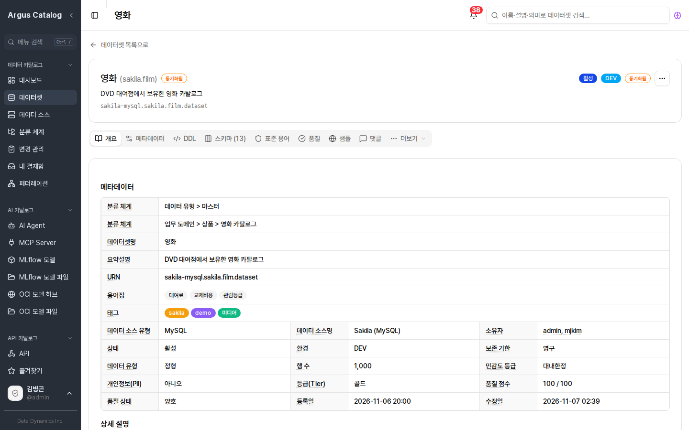
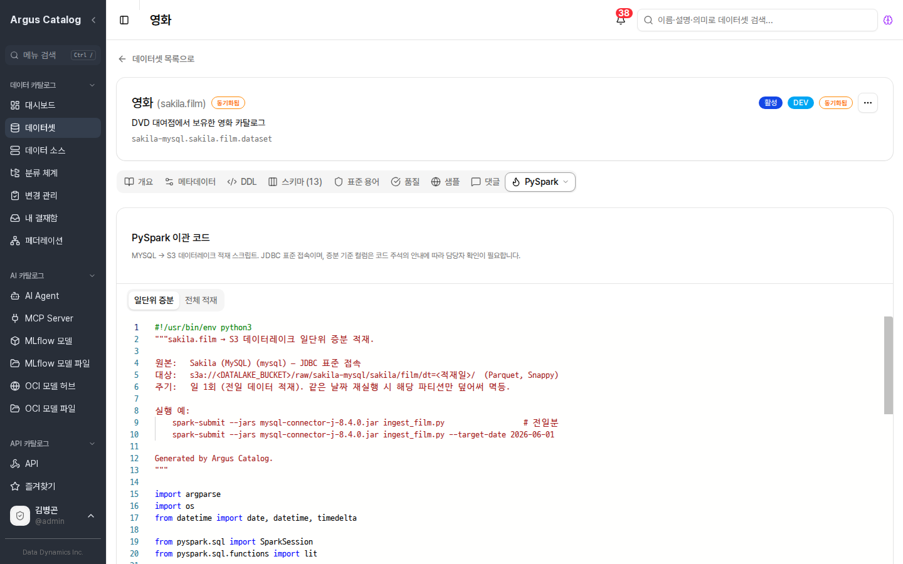

# Argus Catalog

[](https://github.com/DataDynamics-OSS/argus-catalog/actions/workflows/ci.yml)
[](LICENSE)
[](https://www.python.org/)
[](CONTRIBUTING.md)

**Argus Catalog** 는 회사 안에 흩어진 데이터·ML 모델·API·AI 에이전트를 **한 곳에서 찾고, 이해하고, 관리하는**
오픈소스 메타데이터 플랫폼입니다. 데이터 카탈로그와 MLflow 호환 모델 레지스트리를 한 제품으로 묶었고,
인터넷이 차단된 **폐쇄망(에어갭)** 에서도 그대로 동작합니다.

- **찾기** — 이름·설명·의미로 검색(키워드 + 임베딩 시맨틱 검색), 분류 체계·태그·용어집으로 탐색
- **이해하기** — 스키마·DDL·샘플·리니지·ER 다이어그램·데이터 품질 점수를 한 화면에서
- **관리하기** — 소유자·표준·변경 관리(결재)·메뉴/기능 권한·알림
- **모델과 AI 자산까지** — MLflow·OCI 모델, OpenAPI, AI Agent, MCP Server 를 같은 카탈로그에서

<p align="center">
  
  <br><sub>데이터셋 상세 — 분류·용어집·태그·소유자·품질 점수를 한 화면에서</sub>
</p>

<p align="center">
  
  <br><sub>PySpark 탭 — 원천 테이블을 데이터레이크로 옮기는 적재 코드를 자동으로 만들어 줍니다</sub>
</p>

## 5분 만에 띄워 보기

Docker 만 있으면 됩니다. 저장소 루트에서:

```bash
docker compose -f deploy/docker-compose.yml up -d --build
```

| 접속 | 주소 |
|------|------|
| 웹 화면 | http://localhost:3000 |
| API 문서 (Swagger) | http://localhost:4600/docs |

처음 로그인은 `admin` / `admin` 입니다. 로그인하면 **비밀번호 변경 화면**이 먼저 나오니 새 비밀번호로 바꾸세요.
그다음 *데이터 카탈로그 → 데이터 소스* 에서 사내 DB 를 등록하고 메타데이터를 동기화하면 데이터셋이 채워집니다.
샘플 데이터(Sakila)와 다른 구성은 [`deploy/README.md`](deploy/README.md) 를 참고하세요.

> 기본 계정·비밀번호는 로컬 데모용입니다. 운영에 올리기 전에 [운영 환경 보안 설정](#운영-환경-보안-설정-️)을 꼭 확인하세요.

## 무엇을 할 수 있나요

| 영역 | 할 수 있는 일 |
|------|---------------|
| **데이터 카탈로그** | 11종 데이터 소스(MySQL·PostgreSQL·Oracle·SQL Server·Hive·Impala·Trino·StarRocks·Greenplum·Kudu·Iceberg REST) 메타데이터 동기화, 데이터셋 대시보드, 분류 체계, 스키마·DDL·샘플, 컬럼 리니지·ER 다이어그램, 댓글 |
| **데이터 품질** | 원천 DB 직접 프로파일링, 10종 검증 규칙(프로파일 기반 추천 포함), 품질 점수·추세, 예약 검증, 업스트림 품질 경고, 외부 품질 배치(pandas·PySpark) 결과 반입 |
| **거버넌스** | 데이터 표준·용어집·태그, 변경 관리(결재선·영향 분석·통지), 알림(스키마 변경·품질 실패 → 화면 알림·Webhook) |
| **API · AI 자산** | API 카탈로그(OpenAPI 등록·버전 비교·시험 호출), AI Agent 카탈로그, MCP Server 카탈로그(승인 정책·감사·정책 번들 배포) |
| **ML 모델** | MLflow 호환 모델 레지스트리(버전·Stage·성능 비교·모델 카드·리니지), OCI 모델 허브(HuggingFace 가져오기·에어갭 반입), 모델 파일 브라우저 |
| **AI** | LLM(OpenAI·Anthropic·Ollama)으로 설명·컬럼 설명·태그·PII 자동 생성(미리보기 후 적용), 카탈로그 도구를 쓰는 AI 어시스턴트 |
| **페더레이션** | 여러 Argus 인스턴스를 연합해 통합 검색·탐색·리니지, HARVEST 미러, 로컬 승격 |
| **운영** | 로컬·Keycloak(OIDC) 인증, LDAP 사용자 동기화, 사용자 관리, 역할별 메뉴·기능 권한, 쿼리 수집기(Hive·Impala·Trino·StarRocks) |

화면별 사용법은 사용자 매뉴얼([`docs/`](docs), Antora)에 정리돼 있습니다.
모델 반입·조회는 Python SDK 와 `argus-model` CLI([`sdk/`](sdk))로도 할 수 있습니다.

## 저장소 구성

| 디렉터리 | 역할 |
|----------|------|
| [`backend/`](backend) | 카탈로그·모델 레지스트리 서버 (FastAPI, 포트 4600) |
| [`frontend/`](frontend) | 웹 화면 (Next.js) |
| [`ai-service/`](ai-service) | AI 메타데이터 생성·AI 어시스턴트 서비스 (argus-catalog-ai-service, 선택) |
| [`sdk/`](sdk) | 모델 반입·조회용 Python SDK + `argus-model` CLI |
| [`extensions/`](extensions) | 쿼리 수집기·Query Service·Metadata Sync·LDAP User Sync 등 확장 |
| [`quality/`](quality) | 외부 품질 배치 (pandas / PySpark) |
| [`deploy/`](deploy) | Docker Compose 스택 (데모·인프라·운영 오버라이드) |
| [`release/`](release) | 폐쇄망용 설치 묶음(tar.gz + systemd, RPM) 빌드 |
| [`docs/`](docs) | 사용자 매뉴얼 (Antora · PDF) |
| [`tests/`](tests) | 데이터 소스별 통합 테스트 |

## 개발 환경에서 직접 실행

백엔드를 고쳐 가며 개발할 때는 인프라만 컨테이너로 띄우고 서버와 화면은 로컬에서 실행합니다.

```bash
docker compose -f deploy/docker-compose.infra.yml up -d   # MinIO·Temporal·Keycloak·Sakila

cd backend && make dev && make run          # 백엔드 :4600 (uvicorn --reload)
cd frontend && pnpm install && pnpm dev     # 화면 :3000 (Next.js dev)
```

카탈로그 DB(PostgreSQL + pgvector)는 인프라 compose 에 들어 있지 않으니 따로 준비하고,
연결 정보는 `backend/packaging/config/config.properties` 에 적습니다(스키마 DDL 은 같은 폴더의 `argus-catalog-postgresql.sql`).
화면은 기본으로 `http://localhost:4600` 의 API 에 연결됩니다. AI 기능을 쓰려면 [`ai-service/`](ai-service) 를 함께 띄우고
LLM(Ollama 등)을 연결합니다 — 설정 예시는 [`ai-service/.env.example`](ai-service/.env.example).

## 외부 의존성

처음부터 전부 갖출 필요는 없습니다. **필수**가 아닌 항목은 그 기능을 쓸 때만 필요합니다.

| 서비스 | 구분 | 용도 |
|--------|------|------|
| **PostgreSQL** (pgvector) | 필수 | 카탈로그 저장소 + 시맨틱 검색 |
| **오브젝트 스토리지** (MinIO / S3 호환) | 필수 | 모델 파일 저장 (모델 레지스트리 · OCI 모델 허브) |
| **Temporal** | 기본 사용 | 변경 관리 결재 워크플로. 끄면(`temporal.enabled=false`) 변경 요청 제출만 막힘 |
| **Keycloak** | 선택 | OIDC/SSO 인증. 기본은 로컬 인증 |
| **OpenLDAP / AD** | 선택 | LDAP 사용자 동기화 (`extensions/ldap-user-sync`) |
| **LLM** (OpenAI / Anthropic / Ollama) | 선택 | AI 메타데이터 생성 · AI 어시스턴트 |
| **임베딩 모델** | 선택 | 시맨틱 검색. 로컬(sentence-transformers, 오프라인) / OpenAI / Ollama 중 선택 |

## 운영 환경 보안 설정 ⚠️

저장소에 들어 있는 기본값은 **로컬 개발용**입니다. 운영에 올리기 전에 반드시 바꾸세요.

| 항목 | 환경변수 / 위치 | 기본값(개발용) |
|------|-----------------|----------------|
| 관리자 계정 | 첫 로그인 시 변경 | `admin / admin` |
| 로컬 JWT 서명키 | `ARGUS_JWT_SECRET` | 미설정 시 개발용 키(경고 로그) |
| 자격증명 암호화 키 | `ARGUS_SECRET_KEY` | 미설정 시 개발용 패스프레이즈(경고 로그) |
| 카탈로그 DB 계정 | 설정 파일 | `argus / argus` |
| 오브젝트 스토리지 | 설정 파일 | `minioadmin / minioadmin` |
| Keycloak client secret | 설정 파일 | `argus-client-secret` |

`ARGUS_JWT_SECRET`·`ARGUS_SECRET_KEY` 는 충분히 긴 무작위 값으로 정하고, 모든 기본 계정을 교체하세요.
운영 배포 절차는 [`deploy/README.md`](deploy/README.md#운영-배포), 폐쇄망 설치 묶음은 [`release/README.md`](release/README.md) 를 참고하세요.

## 버전 관리

[Semantic Versioning](https://semver.org/lang/ko/) 을 따르며, 루트 `VERSION` 파일이 단일 기준입니다.
규칙과 릴리스 절차는 [VERSIONING.md](VERSIONING.md) 를 참고하세요.

## 라이선스

[Apache License 2.0](LICENSE)

## 후원

본 오픈소스는 **[Data Dynamics Inc](https://www.data-dynamics.io/)** 가 후원 및 기여하고 있습니다.
